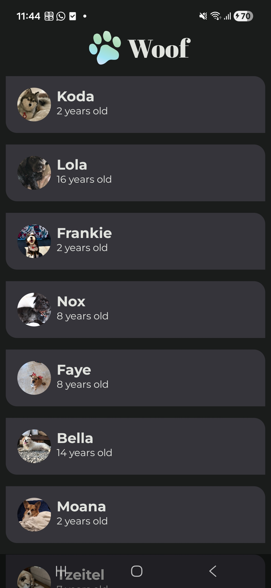
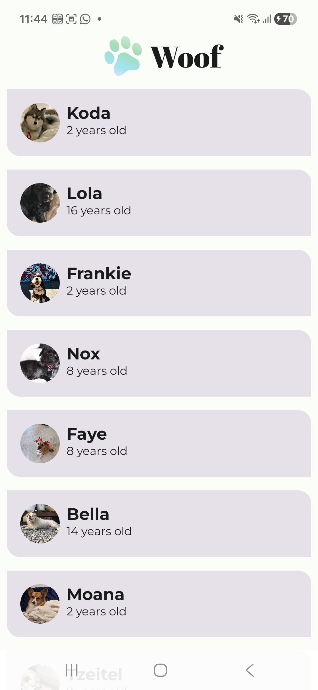

# Clase 15 — Diseño de una lista en Woof

**Universidad:** Mariano Gálvez de Guatemala  
**Curso:** Programación 2  
**Catedrático:** Walter Cordova  
**Estudiante:** José Julián Santiago Hernández  
**Carné:** 0905-25-10952  
**Fecha de la actividad:** 24 de octubre de 2026

## Introducción

En esta práctica se trabajó con la aplicación Woof, desarrollada en Kotlin utilizando Jetpack Compose. El objetivo fue mejorar la presentación de una lista de perros mediante la aplicación de colores, tarjetas, tipografías personalizadas, esquinas redondeadas y una barra superior.

Se utilizó el proyecto inicial proporcionado en el curso, conservando su funcionalidad y realizando modificaciones en los componentes de diseño.

## Objetivo

Aplicar principios básicos de diseño de interfaces en Android para mejorar la organización visual, la legibilidad y la experiencia del usuario.

## Modificaciones realizadas

### 1. Paleta de colores — Color.kt

Se incorporó una paleta de colores verdes para los temas claro y oscuro, estableciendo colores diferentes para fondos, superficies y textos.

### 2. Configuración de temas — Theme.kt

Se configuraron los esquemas de colores para que la aplicación adapte su apariencia según el tema seleccionado en el dispositivo.

### 3. Tarjetas — MainActivity.kt

Se implementó el componente `Card` para mostrar cada perro en una tarjeta individual, utilizando una separación exterior de 8 dp.

### 4. Esquinas redondeadas — Shape.kt

Se configuraron esquinas redondeadas para las tarjetas y fotografías circulares mediante `RoundedCornerShape` y `ContentScale.Crop`.

### 5. Tipografía — Type.kt

Se incorporaron las fuentes Montserrat Regular, Montserrat Bold y Abril Fatface.

Montserrat se utiliza en los nombres y las edades de los perros, mientras que Abril Fatface se utiliza en el título principal.

### 6. Barra superior — MainActivity.kt

Se agregó una barra superior utilizando `CenterAlignedTopAppBar` y `Scaffold`, mostrando el logotipo de Woof y el nombre de la aplicación.

## Pruebas realizadas

Se compiló el proyecto mediante Gradle y se obtuvo el resultado `BUILD SUCCESSFUL`.

Posteriormente, se instaló y ejecutó la aplicación en un dispositivo Android físico, comprobando el funcionamiento de los temas claro y oscuro.

## Evidencias de la aplicación

A continuación se presentan las capturas de pantalla de la aplicación Woof, ejecutada en un dispositivo Android físico.

### 1. Tema claro

En el tema claro se observa una interfaz con colores suaves, tarjetas separadas, fotografías circulares y una barra superior con el logotipo de Woof.

### 2. Tema oscuro

En el tema oscuro se observa la adaptación de los colores del fondo, las tarjetas y los textos, manteniendo una buena legibilidad.

## Aplicación de lo aprendido a Control de Gastos

1. **Tarjetas:** Utilizaría tarjetas con esquinas redondeadas para organizar cada gasto y facilitar su identificación.
2. **Textos:** Destacaría la descripción del gasto en negrita, dejando el monto y la fecha con un tamaño de texto menor.
3. **Colores:** Aplicaría un color principal a la barra superior, manteniendo un contraste adecuado para facilitar la lectura en los temas claro y oscuro.

## Conclusión

Esta actividad permitió comprender cómo los colores, las formas y las tipografías influyen en la presentación de una aplicación Android. Los conocimientos adquiridos pueden utilizarse para mejorar la interfaz de la aplicación Control de Gastos y facilitar su uso.